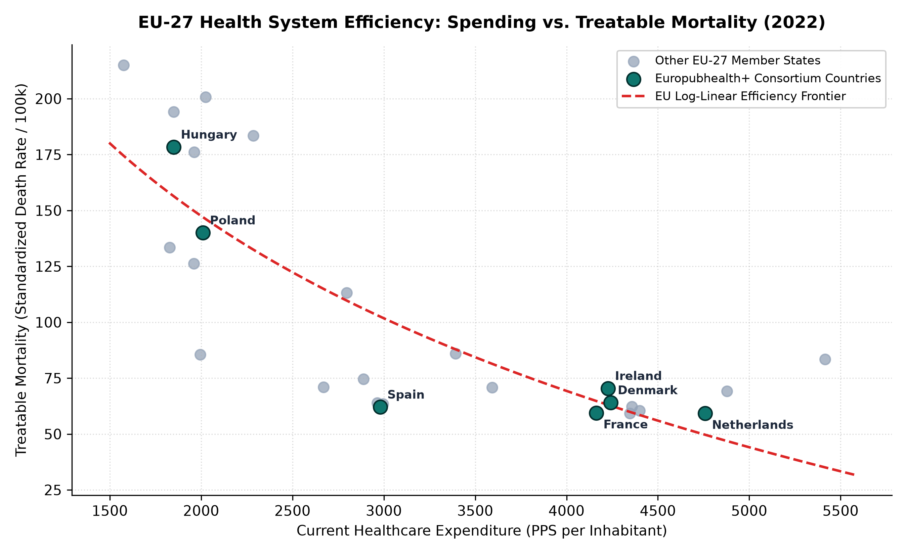
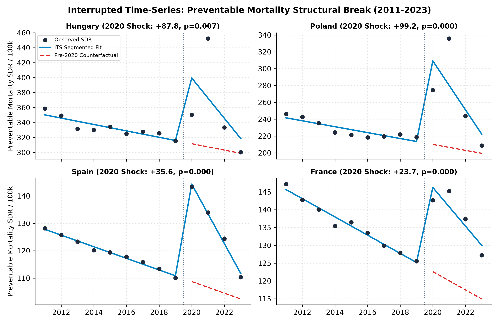
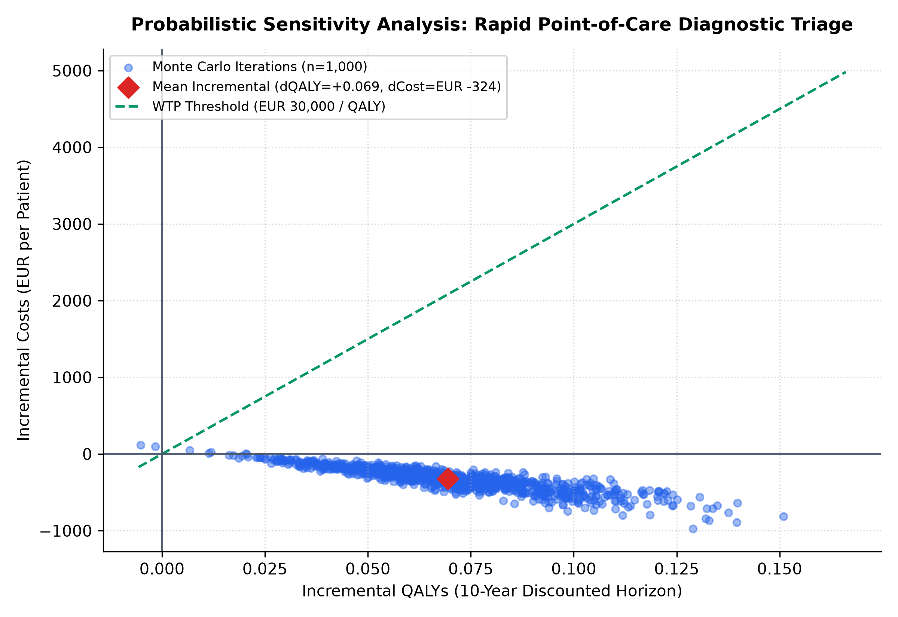

# European Health System Efficiency, Policy Evaluation & HTA Analytics

Quantitative epidemiology, quasi-experimental policy evaluation, and Health Technology Assessment (HTA) toolkit built on real Eurostat health accounts and mortality surveillance data (2011-2023).

---

## Public Health & Health Economics Takeaways

1. **Spending Alone Does Not Explain Avoidable Mortality Disparities:** Across EU-27 member states in 2022, log-linear Preston-curve frontier modeling shows substantial variation in technical efficiency. Among **Europubhealth+ consortium countries**, **Spain** achieves a treatable mortality Standardized Death Rate (SDR) of **62.06 per 100,000** at **2,981 PPS/capita** (-40.4 below expected frontier mortality), whereas **Hungary** records **178.40 per 100,000** at **1,850 PPS/capita** (+22.1 excess mortality above the spending frontier).
2. **Differential Health System Resilience to Structural Shocks:** Segmented Interrupted Time-Series (ITS) regressions with Newey-West HAC standard errors (maxlags=1) show Central/Eastern European systems experienced sharper immediate preventable mortality surges in 2020 (**Poland**: +99.2/100k, p < 0.001; **Hungary**: +87.8/100k, p = 0.007) compared to Western/Southern European peers (**France**: +23.7/100k, p < 0.001; **Spain**: +35.6/100k, p < 0.001).
3. **Diagnostic Triage HTA Cost-Effectiveness:** A 10-year half-cycle-corrected cohort Markov model (3.5% annual discount rate) evaluating rapid point-of-care diagnostic triage (EUR 85/patient, RR = 0.68 for acute complications) against standard empiric care yields a **dominant** economic profile (-EUR 323.73 incremental cost, +0.0697 incremental QALYs, 99.8% probability of cost-effectiveness at a EUR 30,000/QALY willingness-to-pay threshold across 1,000 Monte Carlo draws).

---

## Key Visual Outputs

### 1. EU-27 Health System Efficiency Frontier (Eurostat 2022)

### 2. Interrupted Time-Series: Preventable Mortality Structural Break (2011-2023)

### 3. Probabilistic Sensitivity Analysis: Rapid Point-of-Care Diagnostic Triage

---

## Repository Architecture

- data/raw/ - Local parquet cache from Eurostat dissemination API
- data/processed/ - Cleaned EU-27 longitudinal panel (eu_health_panel.parquet)
- outputs/figures/ - High-resolution static figures (300 DPI)
- scripts/fetch_eurostat.py - Automated Eurostat API ingestion (hlth_cd_apr, hlth_sha11_hf, demo_mlexpec)
- scripts/generate_figures.py - Reproducible figure generation pipeline
- src/disparities.py - EU-27 panel assembly & log-linear efficiency frontier OLS
- src/its_model.py - Segmented ITS regression with Newey-West HAC covariance
- src/markov_hta.py - Cohort Markov state-transition & Gamma/Beta/LogNormal PSA engine
- pp.py - Interactive 3-tab Streamlit dashboard

---

## Reproduction & Local Execution

1. Install dependencies: pip install -r requirements.txt
2. Pull raw Eurostat tables and build the clean EU-27 panel: python scripts/fetch_eurostat.py then python src/disparities.py
3. Regenerate static figures: python scripts/generate_figures.py
4. Launch interactive Streamlit dashboard: streamlit run app.py

## Data Sources
- **Eurostat hlth_cd_apr:** Treatable and preventable mortality of residents by cause and sex (Standardized Death Rate per 100,000 inhabitants).
- **Eurostat hlth_sha11_hf:** Healthcare expenditure by financing scheme (Purchasing Power Standards per inhabitant and % of GDP).
- **Eurostat demo_mlexpec:** Life expectancy by age and sex.
